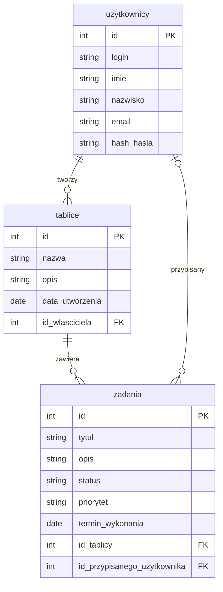

# Opis danych TaskBoard

## Co aplikacja przechowuje

### Użytkownik

| Informacja | Przykład |
| --- | --- |
| ID użytkownika | 1 |
| Login | jan_kowalski |
| Imię | Jan |
| Nazwisko | Kowalski |
| Email | <jan@example.com> |
| Hasło | Przechowywane jako hash |

### Tablica

| Informacja | Przykład |
| --- | --- |
| ID tablicy | 1 |
| Nazwa tablicy | Projekt szkolny |
| Opis | Zadania do wykonania w szkole |
| Data utworzenia | 2026-11-04 |
| Właściciel | jan_kowalski |
| Liczba zadań | 5 |

### Zadanie

| Informacja | Przykład |
| --- | --- |
| ID zadania | 1 |
| Tytuł | Uzupełnić README |
| Opis | Dodać opis projektu TaskBoard |
| Status | W trakcie |
| Priorytet | Wysoki |
| Termin wykonania | 2026-11-06 |
| Przypisana osoba | jan_kowalski |
| ID tablicy | 1 |

## Powiązania

1. Jeden użytkownik może utworzyć wiele tablic, ale każda tablica ma jednego właściciela.
2. Jedna tablica może zawierać wiele zadań, ale każde zadanie należy do jednej tablicy.
3. Jeden użytkownik może mieć przypisanych wiele zadań, ale każde zadanie może być przypisane do maksymalnie jednego użytkownika.

## Przykład zadania w JSON

```json
{
    "id": 1,
    "title": "Uzupełnić README",
    "status": "W trakcie",
    "priority": "Wysoki"
}
```

## Wstępny diagram ERD


